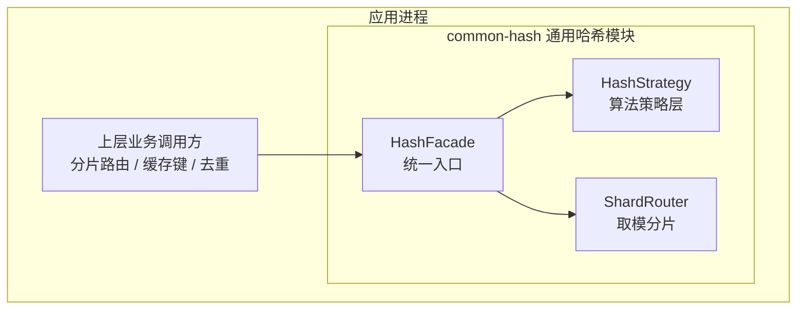
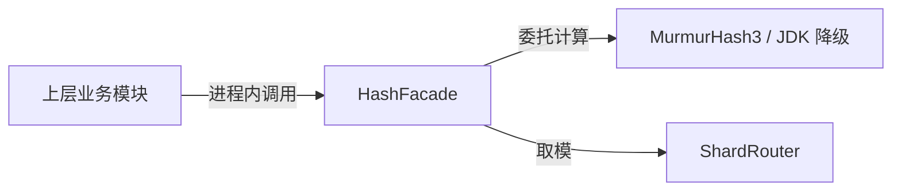
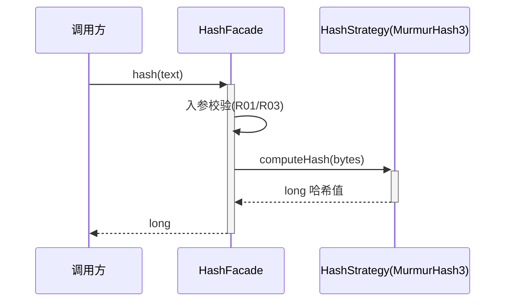

> **文档元信息**
>
> | 项目 | 内容 |
> |------|------|
> | 文档版本 | v1.0 |
> | 作者 | AiWork |
> | 创建日期 | 2026-10-21 |
> | 需求来源 | 用户需求："写个哈希函数" |
> | 评审状态 | 待评审 |

# 通用哈希函数模块 系分设计

## 1. 需求与范围

### 1.1 背景与目标

- **背景**：用户提出"写个哈希函数"，未提供用途、技术栈、输入输出形态等细节；当前仓库为近乎空仓库（仅 README.md，无既有架构文档与历史系分资产），本次为全量新模式设计。
- **目标**：设计一个可复用、无状态、线程安全、跨进程结果一致且性能良好的**通用哈希函数模块**，按默认可解释的推荐假定落地，作为后续分片路由、缓存键生成、去重等场景的基础设施。
- **设计原则**：纯计算、无外部依赖、不引入有状态数据；算法层可插拔；不造需求，所有功能点均有来源依据或明确标注假设。

### 1.2 核心功能

- 输入任意长度字符串或字节序列，输出定长哈希值（64 位长整型为主，支持十六进制字符串形态）。
- 提供哈希值 → 分片/桶索引的映射（取模），供分库分表、负载均衡等路由场景使用。
- 算法策略可插拔（策略接口），支持后续替换或新增算法版本而不影响调用方。

### 1.3 约束与非功能要求

- **性能**：单次计算微秒级、复杂度 O(n)（n 为输入长度）、无锁无状态。
- **稳定性**：同一输入在跨进程、跨 JVM 版本、跨重启场景下结果一致（分片路由稳定性的关键前提）。
- **安全性**：本模块为非加密哈希，不用于安全校验/密码学场景；如后续确认安全场景，另行封装 SHA-256/SM3。
- **边界**：无外部系统、无持久化数据、无网络接口。

### 1.4 排除范围

- 不实现加密哈希（SHA-256/SM3/国密）作为本期核心（除非后续确认安全场景，见 A05）。
- 不实现一致性哈希环（作为后续扩展，本期仅提供基础哈希与取模分片，见 A06）。
- 不提供网络服务接口（oneapi/OpenAPI），本期以进程内库/工具方法形态交付。

### 1.5 需求功能清单与优先级

| 编号 | 功能点 | 优先级 | 需求来源 | 备注 |
|------|--------|--------|----------|------|
| F01 | 通用哈希计算：字符串/字节序列 → 64 位哈希值，支持十六进制形态 | P0 | "写个哈希函数" | 核心 |
| F02 | 分片映射：哈希值 → 分片/桶索引（取模） | P1 | 推测路由场景 | 假设 A01 |
| F03 | 算法策略可插拔（可替换/新增算法版本） | P2 | 稳健性设计 | 扩展 |

### 1.6 假设与待确认项

| 编号 | 假设/待确认内容 | 当前假设 | 确认状态 |
|------|-----------------|----------|----------|
| A01 | 用途/场景 | 分库分表/缓存分片路由（非加密快速哈希） | 待确认 |
| A02 | 技术栈/语言 | Java（数科 Java 规范，宿主服务内工具类形态） | 待确认 |
| A03 | 输入类型 | 字符串 + 字节序列 | 待确认 |
| A04 | 输出形态 | 64 位长整型为主，支持十六进制字符串 | 待确认 |
| A05 | 是否需要安全哈希/加密 | 不需要 | 待确认 |
| A06 | 是否需要一致性哈希 | 不需要，作为后续扩展 | 待确认 |
| A07 | 输入长度上限 | 单次输入上限 1 MiB，超出报错（防 DoS） | 待确认 |

## 2. 架构与模块

### 2.1 功能架构

- **交互层说明**：本模块为进程内库，无 Web 控制台/网关交互层。
- **核心服务层说明**：common-hash 模块提供统一的 `HashFacade` 入口，内部委托 `HashStrategy` 完成算法计算、委托 `ShardRouter` 完成取模分片。
- **扩展/集成层说明**：算法实现以策略方式挂载，便于替换/新增算法版本。

### 2.2 模块清单

| 模块/组件 | 职责 | 依赖 |
|-----------|------|------|
| HashFacade | 统一入口，入参校验、算法规制、返回形态转换 | HashStrategy、ShardRouter |
| HashStrategy | 算法策略抽象与实现（推荐 MurmurHash3，降级 JDK 内置） | 无 |
| ShardRouter | 哈希值取模映射到分片/桶索引 | 无 |

### 2.3 应用集成架构

**集成关系说明：**

| 调用方 | 被调用方 | 协议 | 接口类型 | 说明 |
|--------|----------|------|----------|------|
| 上层业务模块 | HashFacade | 进程内方法调用 | 内部接口 | 哈希计算与分片 |
| HashFacade | HashStrategy | 进程内方法调用 | 内部接口 | 算法实现 |
| HashFacade | ShardRouter | 进程内方法调用 | 内部接口 | 取模分片 |

本模块无外部系统、无中间件依赖。

### 2.4 部署架构

作为库/工具类随宿主应用部署（同进程、同 JVM），无独立部署单元、无单点问题。无需负载均衡、主从等部署组件。

## 3. 数据模型与存储

本项不适用，原因：本模块为纯计算、无状态，无持久化实体、无数据库表、无缓存/MQ。

## 4. 接口设计

### 4.1 oneapi（Web 控制台接口）

本项不适用，原因：本模块以进程内库交付，不提供 HTTP 接口。

### 4.2 OpenAPI（对外接口）

本项不适用，原因：同上。

### 4.3 内部接口（Service/工具方法层）

| 编号 | 接口名称 | 类 | 方法签名 |
|------|----------|------|----------|
| S01 | 字符串哈希 | HashFacade | long hash(String text) |
| S02 | 字节流哈希 | HashFacade | long hashBytes(byte[] data) |
| S03 | 十六进制哈希 | HashFacade | String hashToHex(String text) |
| S04 | 分片索引 | ShardRouter | int shardIndex(long hash, int shardCount) |

### 4.4 集成接口（Integration 层）

本项不适用，原因：无外部系统集成。

## 5. 功能模块设计

### 5.1 common-hash 模块

全局约定：

- **错误码格式**：`HASH_{SEQ}`。
- **通用出参结构**：本模块为方法返回值直出，不封装 `{code,msg,data}`（工具类形态）；异常以统一业务异常抛出。

#### 5.1.1 表结构设计

本项不适用，原因：无持久化数据，不涉及数据库表。

##### 枚举与常量定义

| 枚举名称 | 取值 | 含义 | 关联字段 |
|----------|------|------|----------|
| 算法类型 | MURMUR3_128 | 推荐算法（128 位取 64 位） | 算法策略标识 |
| 算法类型 | JDK | 降级算法（兜底） | 算法策略标识 |
| 常量 | 1 MiB | 单次输入长度上限 | 输入校验 |
| 常量 | 0 | 分片下标起始值 | 取模结果 |

#### 5.1.2 接口详细设计

**S01 hash(String text)**

- 描述：计算字符串的 64 位哈希值。
- 入参：

| 参数名称 | 类型 | 是否必填 | 描述 |
|----------|------|----------|------|
| text | String | 是 | 待哈希字符串，非空、非 null |

- 出参：long（64 位哈希值）。
- 错误码：

| 错误码 | 说明 |
|--------|------|
| HASH_001 | 入参为空（null 或空串） |
| HASH_003 | 输入长度超过上限（1 MiB） |

**S02 hashBytes(byte[] data)**

- 描述：计算字节序列的 64 位哈希值。
- 入参：

| 参数名称 | 类型 | 是否必填 | 描述 |
|----------|------|----------|------|
| data | byte[] | 是 | 待哈希字节序列，非空、非 null |

- 出参：long（64 位哈希值）。
- 错误码：HASH_001（空入参）、HASH_003（超长）。

**S03 hashToHex(String text)**

- 描述：计算字符串哈希并以十六进制字符串形态返回（便于日志、存储、对比）。
- 入参：同 S01 的 text。
- 出参：String（十六进制哈希串，定长）。

**S04 shardIndex(long hash, int shardCount)**

- 描述：将 64 位哈希值取模映射到 [0, shardCount) 的分片/桶索引，结果恒为非负。
- 入参：

| 参数名称 | 类型 | 是否必填 | 描述 |
|----------|------|----------|------|
| hash | long | 是 | 已计算的哈希值 |
| shardCount | int | 是 | 分片/桶总数，必须 > 0 |

- 出参：int（分片索引）。
- 错误码：

| 错误码 | 说明 |
|--------|------|
| HASH_002 | 分片数非法（≤ 0） |

#### 5.1.3 子功能详细设计

**5.1.3.1 通用哈希计算（F01）**

**业务规则：**

| 规则编号 | 规则描述 | 校验时机 | 不满足时的处理 |
|----------|----------|----------|---------------|
| R01 | 输入不得为 null/空 | 计算前 | 返回错误码 HASH_001 |
| R02 | 同一输入必须跨进程/跨版本结果一致 | 始终 | 使用无随机种子的确定性算法（MurmurHash3，固定 seed） |
| R03 | 输入长度不超过上限 | 计算前 | 返回错误码 HASH_003 |
| R04 | 算法选型由配置指定，缺省为 MurmurHash3 | 每次调用 | 缺省使用推荐算法，异常时降级 JDK |

**异常场景：**

| 异常场景 | 处理方式 |
|----------|----------|
| 入参为 null/空 | 抛统一业务异常（HASH_001），不返回默认值 |
| 输入超长 | 抛统一业务异常（HASH_003），避免超大输入拖垮计算 |
| 算法实现内部异常 | 降级至 JDK 内置算法兜底，并记录告警日志 |

**并发控制：**

- 并发场景：本模块无共享可变状态，纯函数计算，天然线程安全。
- 控制策略：无并发风险，原因：不持有可变成员变量，算法实例为无状态单例。

**状态机设计：**

本项不适用，原因：本模块无状态实体、无生命周期状态字段。

**技术选型方案对比（哈希算法）：**

| 方案 | 优点 | 缺点 |
|------|------|------|
| JDK 内置 hashCode | 内置零依赖、实现简单 | 仅 32 位、碰撞率高、跨 JVM 版本不稳定、可能为负值、含随机种子问题 |
| MurmurHash3 | 速度快、分布均匀、64/128 位输出、纯 Java 实现、无随机种子、跨进程稳定 | 非加密、存在理论碰撞 |
| xxHash | 大字节流下极快 | Java 生态支持较少、引入可选依赖 |
| SHA-256 | 安全、抗碰撞 | 计算慢、并非分片路由最佳选择 |

**推荐方案**：MurmurHash3（128 位取低 64 位或聚合 64 位）。
**推荐理由**：分布均匀、跨进程跨版本结果稳定（满足 R02 路由稳定性）、纯 Java 无额外依赖、性能满足微秒级要求；非加密场景可忽略理论碰撞。降级兜底选用 JDK 内置实现。

## 6. 非功能性需求设计

### 6.1 高可用性

本模块随宿主进程运行，无独立可用性风险；纯计算无外部依赖，不存在第三方异常降级需求。

### 6.2 可扩展性

算法策略可插拔：新增算法或换代算法通过新增策略实现即可，不改动调用方；分片数量可由配置指定，支持横向扩容分片数。

### 6.3 稳定性/可靠性

- 边界输入（空、超长、奇数/偶数长度、单个字符、全 ASCII 与非 ASCII）结果稳定可预期。
- 确定性：固定 seed、无随机因子，保证幂等与跨实例一致。

### 6.4 安全性设计

- **账户/鉴权**：不适用（进程内工具，无用户体系）。
- **授权与访问控制**：不适用（无对外接口、无数据读取）。
- **数据防护**：本模块为非加密哈希，禁止用于安全校验/密码学用途；敏感数据指纹/校验场景需另行接入 SHA-256/SM3（待确认 A05）。
- **输入防护**：输入长度上限（1 MiB）防资源耗尽 DoS。

### 6.5 监控/统计/日志/告警

埋点记录哈希调用量、平均/累计耗时、各分片命中分布；算法降级（JVM 兜底）时告警。

## 7. 变更三板斧

### 7.1 可监控

- 调用量/QPS：衡量模块使用热度与容量。
- 处理耗时：发现性能回退。
- 分片分布：监控各分片命中是否均匀，发现路由倾斜。

### 7.2 可灰度

哈希算法变更需谨慎（影响存量分片映射）。灰度方案：提供算法版本配置，按租户/业务线灰度切换新算法，对比新旧算法分片分布一致性后再全量。

### 7.3 可应急

- 保留算法开关：一键切回旧算法（配置项，避免改码）。
- 算法降级兜底：推荐算法异常自动降级 JDK 内置实现。
- 回滚关注：哈希结果变更会改变分片路由，回滚时需与应用侧分片/缓存键映射保持一致，避免路由错乱。

## 8. 方案检查（Step 9 checklist）

| 检查项 | 结果 | 说明 |
|--------|------|------|
| 模块划分合理性 | 通过 | 单一职责、无循环依赖、无超大模块 |
| 依赖关系合理性 | 通过 | 无外部依赖，纯进程内 |
| 单点问题（部署） | 通过 | 随宿主进程，无独立部署单点 |
| 表模型设计范式 | 不适用 | 无持久化表 |
| 隐私安全检查 | 通过 | 无敏感信息流转；明确禁止用于安全校验 |
| 兼容性检查（接口） | 通过 | 初始设计，无存量调用方；策略接口向后兼容新增算法 |
| 兼容性检查（表） | 不适用 | 无表 |
| 数据迁移检查 | 不适用 | 无表数据 |
| 一致性检查（功能点） | 通过 | F01/F02/F03 均在 5.1 有对应设计 |
| 一致性检查（表） | 不适用 | 无实体 |
| 一致性检查（接口） | 通过 | S01~S04 均有详细定义 |
| 一致性检查（枚举） | 通过 | 枚举与约定一致 |
| 状态机完整性 | 不适用 | 无状态实体 |
| 并发风险检查 | 通过 | 无共享可变状态，线程安全 |
| 单点问题（定时任务） | 不适用 | 无定时任务 |
| 非功能性可行性 | 通过 | 纯计算，性能/稳定性要求可落地 |
| 可监控 | 通过 | 已定义埋点 |
| 可灰度 | 通过 | 算法版本配置灰度，附对比方案 |
| 可应急 | 通过 | 算法开关 + 降级兜底，关注分片一致性 |